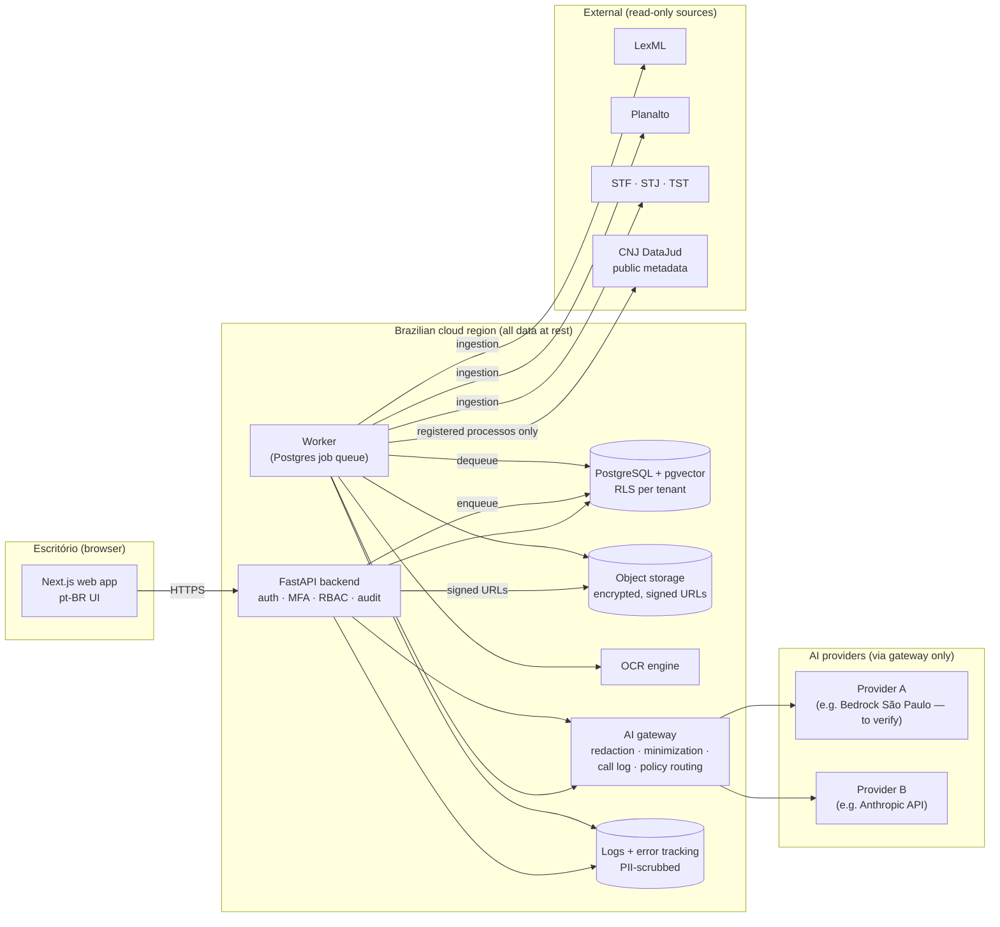
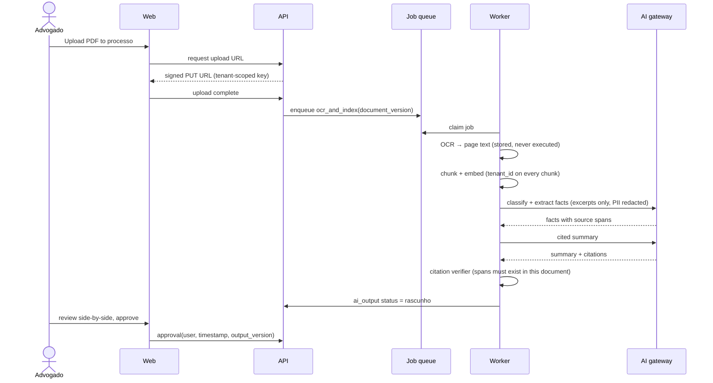
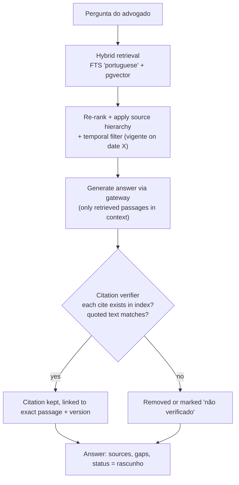
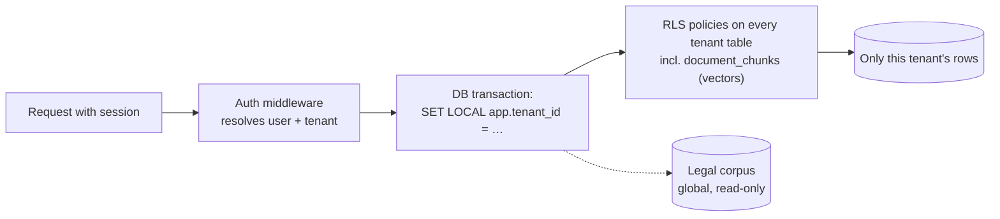

# Architecture (Phase 0 proposal)

Plain-language summary: the lawyer uses a web app. The web app talks to one
backend API. Slow work (OCR, AI summaries, corpus ingestion) runs in a
background worker. Everything is stored in one PostgreSQL database and one
file store, both in Brazil. Every call to an AI model passes through a single
"AI gateway" that strips personal data, logs the call, and picks the provider.

## 1. System overview

Notes:
- There is **no path** from an agent to send email, file at court, or call any
  external write API (brief §4). External connectors are read-only ingestion.
- Whether the AI model can run in São Paulo is open (`docs/VERIFY.md` §AI). If
  it cannot, gateway calls are an international data transfer under LGPD and
  the redaction + SCC work in Phase 6 becomes mandatory before pilot.

## 2. Document intelligence flow (Phase 2)

## 3. Research with verified citations (Phase 3)

## 4. Tenant isolation

- The application connects with a database role that **does not own** the
  tables and has no `BYPASSRLS`, so a forgotten `WHERE tenant_id = …` cannot
  leak data.
- Vector search runs on the same RLS-protected table; Phase 1 includes a test
  proving tenant A's similarity search never returns tenant B's chunks.
- Object storage keys are prefixed by tenant; the API only signs URLs for keys
  belonging to the caller's tenant.
- Cache keys and log records carry the tenant id; logs never contain document
  text or raw prompts by default.

## 5. AI gateway responsibilities

| Responsibility | How |
|---|---|
| Minimization | Callers pass only the excerpts a task needs; gateway enforces a max context per purpose |
| Redaction | Detect CPF, CNPJ, RG, OAB nº, CEP/addresses, phone, email, health terms; replace with stable placeholders; re-insert on the way back. Per-firm policy |
| Logging | provider, model, purpose, tenant, matter, token counts, cost, latency — **no raw prompt** unless the firm opts in for debugging |
| Routing | Provider abstraction; policy chooses provider/model per purpose and per firm (e.g. "in-Brazil only") |
| Limits | Per-firm cost and rate limits (hardened in Phase 6) |
| Injection defense | Document text is wrapped as quoted data; system prompts state it is untrusted; agents have scoped tools only |
