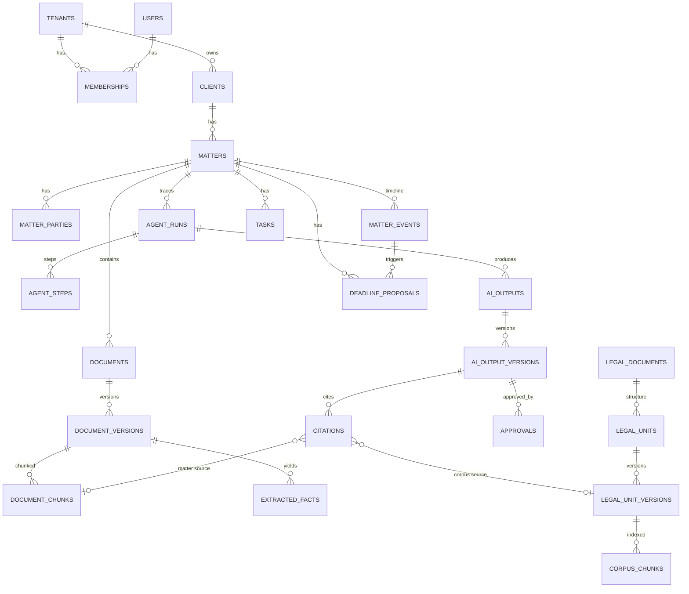

# Data model (Phase 0 proposal)

Plain-language summary: there are two kinds of data. **Firm data** (clients,
processos, documents, AI outputs, deadlines) belongs to exactly one firm and is
locked to it by the database itself. **Legal corpus** (laws, súmulas,
decisions) is public and shared by everyone, read-only.

Tables are introduced phase by phase; the "Phase" column says when.

## 1. Conventions

- Primary keys: random UUIDs (v4). Time-sortable UUID v7 can replace them later without
  schema changes if index locality ever matters.
- Every firm-scoped table: `tenant_id uuid not null` + RLS policy
  `tenant_id = current_setting('app.tenant_id')::uuid`.
- Timestamps: `created_at`, `updated_at` (timestamptz, UTC; displayed in
  America/Sao_Paulo).
- Soft delete only where a legal hold or audit trail requires it; real
  deletion goes through the LGPD deletion workflow (Phase 6).
- Sensitive identifiers (CPF, CNPJ, RG) stored encrypted at the column level
  plus a keyed hash for lookup.
- AI outputs are **immutable versions**: edits create a new version; approvals
  point to a specific version.

## 2. Firm data (tenant-scoped)

### Identity, access, audit — Phase 1

| Table | Key fields | Notes |
|---|---|---|
| `tenants` | name, cnpj, plan, settings (jsonb: redaction policy, AI routing policy, retention defaults) | One row per escritório. Not RLS'd by tenant_id but by id |
| `users` | email, name, password_hash (argon2id), oab_number, oab_uf, status | A user can belong to more than one firm (rare, but true for some lawyers) |
| `memberships` | tenant_id, user_id, role (`socio`, `advogado`, `estagiario`, `administrativo`) | Role is per firm |
| `mfa_factors` | user_id, type (totp / webauthn), secret_encrypted, confirmed_at | |
| `sessions` | user_id, tenant_id, expires_at, ip, user_agent | Server-side sessions |
| `audit_log` | tenant_id, actor_user_id, action, entity_type, entity_id, at, ip, metadata | Append-only. Includes every read of sensitive documents |

### Clients and matters — Phase 2

| Table | Key fields | Notes |
|---|---|---|
| `clients` | tenant_id, kind (PF/PJ), name, cpf_cnpj_encrypted, contact | |
| `matters` (processo) | tenant_id, client_id, cnj_number (NNNNNNN-DD.AAAA.J.TR.OOOO, nullable for pre-litigation), court, comarca, vara, area (trabalhista, cível, consumidor…), status, opened_at | Center of the product |
| `matter_parties` | tenant_id, matter_id, name, role (autor, réu, parte contrária, terceiro…), represented_by | |
| `matter_members` | tenant_id, matter_id, user_id, responsibility | Who works on it |
| `matter_events` (timeline) | tenant_id, matter_id, kind (movimentação, intimação, publicação, upload, AI output, approval), occurred_at, source (manual / datajud / document), payload | |

### Documents — Phase 2

| Table | Key fields | Notes |
|---|---|---|
| `documents` | tenant_id, matter_id, title, doc_class (petição, decisão, sentença, contrato, procuração…), classified_by (ai/user) | |
| `document_versions` | tenant_id, document_id, storage_key, sha256, mime, pages, ocr_status | Files are immutable; new upload = new version |
| `document_pages` | tenant_id, document_version_id, page_no, text, ocr_confidence | Extracted text, treated as untrusted data |
| `document_chunks` | tenant_id, document_version_id, page_from, page_to, char_start, char_end, text, tsv (tsvector), embedding (vector) | RLS applies to vector search too |
| `extracted_facts` | tenant_id, document_version_id, fact_type (date, value, party, pedido…), value, source_chunk_id, char_start, char_end, confidence | Every fact points to its exact span |

### AI work, review, approval — Phases 2–4

| Table | Key fields | Notes |
|---|---|---|
| `agent_runs` | tenant_id, matter_id, workflow (summary, research, drafting, deadline), status, started_by, started_at, finished_at | The auditable trace |
| `agent_steps` | tenant_id, agent_run_id, seq, kind (tool_call / model_call), tool_name, input_ref, output_ref, gateway_call_id | |
| `ai_outputs` | tenant_id, matter_id, agent_run_id, kind (summary, research_answer, draft, task_proposal), status (`rascunho`, `em_revisao`, `aprovado`, `rejeitado`) | |
| `ai_output_versions` | tenant_id, ai_output_id, version_no, content (structured), gaps ("fatos faltantes"), confidence, created_by (ai/user) | Immutable |
| `citations` | tenant_id, ai_output_version_id, target_type (corpus / document), corpus_unit_version_id or document_chunk_id, quoted_text, char_start, char_end, verification (`verificado`, `nao_verificado`, `removido`), verifier_notes | Result of the citation verifier |
| `approvals` | tenant_id, ai_output_version_id, approver_user_id, decision, comment, at | Rule 2 of the brief |
| `gateway_calls` | tenant_id, purpose, provider, model, region, input_tokens, output_tokens, cost_brl, latency_ms, redaction_count, prompt_stored (bool) | No raw prompt by default |

### Drafting — Phase 4

| Table | Key fields | Notes |
|---|---|---|
| `templates` | tenant_id (nullable = system template), kind (petição inicial, contestação, notificação extrajudicial, contrato), body, variables | Firm can copy and edit system templates |
| `drafts` | tenant_id, matter_id, template_id, ai_output_id | Content lives in `ai_output_versions`; .docx generated on export |

### Deadlines and tasks — Phase 5

| Table | Key fields | Notes |
|---|---|---|
| `holiday_calendars` | tenant_id (nullable = system), court, comarca, year | Data, not code. Firms can add local holidays |
| `holidays` | calendar_id, date, name, kind (feriado, ponto facultativo, suspensão de expediente), source | |
| `deadline_proposals` | tenant_id, matter_id, trigger_event_id, rule_set (cpc, clt, juizados), rule_id, days, counting (dias úteis/corridos), doubled_reason, proposed_date, reasoning (jsonb, step by step), status (`proposto`, `confirmado`, `rejeitado`), confirmed_by, confirmed_at | Never auto-confirmed |
| `tasks` | tenant_id, matter_id, title, due_at, assignee, origin (manual / deadline / ai proposal), status | |
| `datajud_links` | tenant_id, matter_id, cnj_number, tribunal, last_synced_at | Only processos the firm registers |

### Compliance — Phase 6 (modelled early, built later)

`retention_policies`, `legal_holds`, `data_subject_requests`, `incident_log`,
`processing_records` — all tenant-scoped. Billing is out of MVP; `gateway_calls`
and a future `usage_events` table give billing what it needs later without
schema changes to existing tables.

## 3. Legal corpus (global, read-only to tenants) — Phase 3

| Table | Key fields | Notes |
|---|---|---|
| `corpus_sources` | name (LexML, Planalto, STF, STJ, TST), base_url, terms_checked_at | |
| `ingestion_runs` | source_id, started_at, finished_at, status, stats, code_version | Re-runnable, idempotent |
| `legal_documents` | type, issuing_body, identifier (e.g. URN LexML or "Súmula Vinculante 13"), title, publication_date, source_url | One law, one súmula, one decision |
| `legal_units` | legal_document_id, parent_id, unit_type (livro, título, capítulo, artigo, parágrafo, inciso, alínea, ementa, relatório, voto, dispositivo), label ("art. 219, parágrafo único"), path | Structural tree |
| `legal_unit_versions` | legal_unit_id, text, valid_from, valid_to, status (`vigente`, `revogado`, `alterado`), amended_by, content_hash, retrieved_at, source_url | Temporal validity (rule 4) |
| `corpus_chunks` | legal_unit_version_id, text, tsv, embedding | Chunk = one structural unit, never a fixed token window |

**Source hierarchy** (`legal_documents.type`, each with a weight used in
ranking and shown in the UI): `legislacao` · `sumula_vinculante` ·
`precedente_qualificado` (repetitivo, repercussão geral, IRDR, IAC) ·
`sumula` · `decisao` · `doutrina`. The exact weights are a product decision to
make with a lawyer in Phase 3.

## 4. Core ER diagram

## 5. Glossary (code ↔ domain)

| Code | Domain (pt-BR) |
|---|---|
| `Tenant` | Escritório |
| `Matter` | Processo / caso (pre-litigation matters have no CNJ number) |
| `MatterEvent` | Movimentação, intimação, publicação |
| `Client` | Cliente |
| `MatterParty` | Parte (autor, réu, parte contrária) |
| `Draft` | Peça / minuta |
| `DeadlineProposal` | Prazo proposto |
| `AiOutput.status` | rascunho / em revisão / aprovado |
| `LegalUnit` | Dispositivo (artigo, parágrafo, inciso, alínea) |
