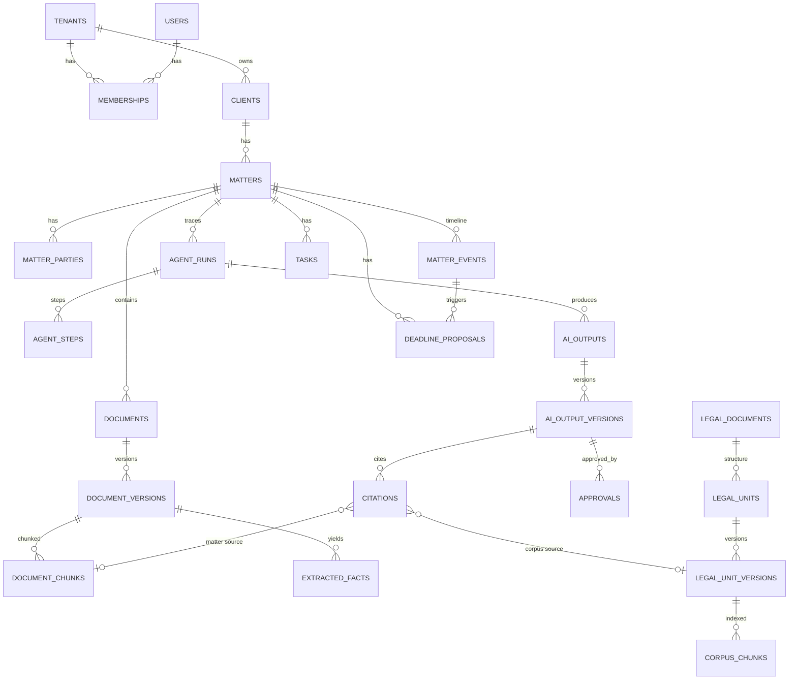

# Data model

Plain-language summary: there are two kinds of data. **Firm data** (clients,
processos, documents, AI outputs, deadlines) belongs to exactly one firm and is
locked to it by the database itself. **Legal corpus** (laws, súmulas,
decisions) is public and shared by everyone, read-only.

Tables are introduced phase by phase; the headings say when. Phases 1 and 2a are
implemented (migrations `0001`, `0002`); later sections are still the plan.

## 1. Conventions

- Primary keys: random UUIDs (v4). Time-sortable UUID v7 can replace them later without
  schema changes if index locality ever matters.
- Every firm-scoped table: `tenant_id uuid not null` + RLS policy
  `tenant_id = current_setting('app.tenant_id')::uuid`.
- Timestamps: `created_at`, `updated_at` (timestamptz, UTC; displayed in
  America/Sao_Paulo).
- Soft delete only where a legal hold or audit trail requires it; real
  deletion goes through the LGPD deletion workflow (Phase 6).
- Sensitive identifiers (CPF, CNPJ, RG) stored encrypted at the column level
  plus a keyed hash for lookup. APIs show them masked (`***.982.247-**`) except in a
  detail view whose read is audited.
- Foreign keys between firm tables are **composite** (`tenant_id`, `id`), so the
  database refuses to link rows of two different firms, even for the owner role.
- AI outputs are **immutable versions**: edits create a new version; approvals
  point to a specific version.

## 2. Firm data (tenant-scoped)

### Identity, access, audit — Phase 1

| Table | Key fields | Notes |
|---|---|---|
| `tenants` | name, cnpj, plan, settings (jsonb: redaction policy, AI routing policy, retention defaults) | One row per escritório. Not RLS'd by tenant_id but by id |
| `users` | email, name, password_hash (argon2id), oab_number, oab_uf, status | A user can belong to more than one firm (rare, but true for some lawyers) |
| `memberships` | tenant_id, user_id, role (`socio`, `advogado`, `estagiario`, `administrativo`) | Role is per firm |
| `mfa_factors` | user_id, type (totp / webauthn), secret_encrypted, confirmed_at | |
| `sessions` | user_id, tenant_id, expires_at, ip, user_agent | Server-side sessions |
| `audit_log` | tenant_id, actor_user_id, action, entity_type, entity_id, at, ip, metadata | Append-only. Includes every read of sensitive documents |

### Clients and matters — Phase 2a (implemented)

| Table | Key fields | Notes |
|---|---|---|
| `clients` | tenant_id, kind (PF/PJ), name, document_number_encrypted + document_number_hash (CPF or CNPJ, incl. alphanumeric CNPJ), email, phone, notes | CPF/CNPJ unique per firm |
| `matters` (processo) | tenant_id, client_id, title, cnj_number (NNNNNNN-DD.AAAA.J.TR.OOOO, check digits validated, nullable for pre-litigation), court, comarca, vara, area (trabalhista, civel, tributario, consumidor, familia, previdenciario, empresarial, outro), status (ativo, suspenso, encerrado, arquivado), description, opened_at | CNJ number unique per firm |
| `matter_parties` | tenant_id, matter_id, name, kind, role (autor, reu, reclamante, reclamada, exequente, executado, terceiro, outro), is_client, document number (encrypted + hash) | |
| `matter_members` | tenant_id, matter_id, user_id, responsibility (responsavel / equipe) | Who works on it. Foreign key to `memberships`, so only firm members can be assigned |
| `matter_events` (timeline) | tenant_id, matter_id, kind (processo_criado, documento_enviado, documento_ready, parte_adicionada, status_alterado… later movimentação, intimação, AI output, approval), summary (pt-BR), source (manual / sistema / datajud), actor_user_id, payload, occurred_at | Append-only for the app |

### Documents — Phase 2a (implemented)

| Table | Key fields | Notes |
|---|---|---|
| `documents` | tenant_id, matter_id, title, doc_class (filled by classification in 2b), current_version_id | |
| `document_versions` | tenant_id, document_id, version_no, storage_key, original_filename, declared_content_type, detected_type (from content), size_bytes, sha256, page_count, ocr_page_count, min_ocr_confidence, status (pending_upload → uploaded → processing → ready / failed / rejected), error_code | Files are immutable; new upload = new version. `documents.current_version_id` = newest ready version |
| `document_pages` | tenant_id, document_version_id, page_number, text, method (text_layer / ocr / docx), ocr_confidence | Extracted text, treated as untrusted data |
| `document_chunks` | tenant_id, document_version_id, page_number, char_start, char_end, text, tsv (generated, `portuguese`), embedding (vector, filled from Phase 3) | Never crosses pages; `page.text[char_start:char_end] == text`. RLS applies to text and vector search |
| `extracted_facts` | tenant_id, document_version_id, fact_type (date, value, party, pedido…), value, source_chunk_id, char_start, char_end, confidence | Every fact points to its exact span |

### AI work, review, approval — Phase 2b (implemented for document analysis)

| Table | Key fields | Notes |
|---|---|---|
| `ai_runs` | tenant_id, matter_id, document_version_id, workflow (`document_analysis`; later research, drafting, deadlines), status (queued / running / succeeded / failed), error_code, started_by | The auditable trace of each AI workflow, linked to the matter |
| `gateway_calls` | tenant_id, ai_run_id, user_id, purpose, provider, model (the one that answered), status (ok / refused / truncated / error), input/output/cache tokens, cost_usd, latency_ms, redaction_count, request_id | Append-only. **No prompt or answer text** |
| `ai_outputs` | tenant_id, matter_id, document_version_id, ai_run_id, kind (`facts`, `summary`; later research_answer, draft, task_proposal), status (`rascunho`, `em_revisao`, `aprovado`, `rejeitado`), current_version_no | |
| `ai_output_versions` | tenant_id, ai_output_id, version_no, content (jsonb: facts or summary segments, discarded count, partial flag, provider), created_by_ai, created_by, note | Immutable; removing items creates a new version |
| `ai_citations` | tenant_id, ai_output_version_id, item_index, document_version_id, page_number, char_start, char_end, quoted_text, verification (`verificado` / `nao_verificado`) | Positions point into `document_pages.text`. Corpus citations arrive in Phase 3 |
| `ai_approvals` | tenant_id, ai_output_version_id, approver_user_id (must be a firm member), decision, comment, decided_at | Append-only. Rule 2 of the brief |

Also: `tenants.ai_monthly_budget_usd` (default 50) and `tenants.ai_redaction_enabled`
(default true); `documents.doc_class_source` (`ai` or `user`; the AI never overwrites a
type set by a person).

### Research and drafting — Phases 3 and 4 (implemented)

No new firm tables. A research question or a draft is an `ai_runs` row (`workflow` =
`legal_research` or `drafting`; `input` jsonb holds the question and date, or the
template id and instructions; `matter_id` is optional for research) with one
`ai_outputs` row (`kind` = `research_answer` or `draft`). `ai_citations` rows point
either at a document page (`document_version_id`) or at a legal provision
(`legal_unit_version_id`), never both. Draft templates live in code
(`drafting/templates.py`) until firms need to edit them.

### Deadlines and tasks — Phase 5 (implemented, without DataJud)

| Table | Key fields | Notes |
|---|---|---|
| `holidays` | tenant_id (NULL = national, shipped with the system), day, name, kind (feriado, ponto_facultativo, suspensao_expediente), scope, source, created_by | Data, not code. Firms see national rows plus their own |
| `deadline_proposals` | tenant_id, matter_id, title, rule_set (cpc, clt, jec), preset_id, trigger_kind, trigger_date, days, unit (dias úteis/corridos), doubled_reason, proposed_date, steps (jsonb, the reasoning), status (`proposto`, `confirmado`, `rejeitado`), confirmed_date, decided_by, decided_at, decision_note | Never auto-confirmed |
| `tasks` | tenant_id, matter_id, title, due_date, assignee_user_id, notes, origin (manual / prazo), deadline_proposal_id, status (aberta, concluida, cancelada) | A confirmed deadline creates one |
| `datajud_links` *(planned)* | tenant_id, matter_id, cnj_number, tribunal, last_synced_at | Only processos the firm registers; waits for VERIFY SRC-6 |

Also: `users.must_change_password` (set when a sócio creates an account with a temporary
password).

### Compliance — Phase 6 (modelled early, built later)

`retention_policies`, `legal_holds`, `data_subject_requests`, `incident_log`,
`processing_records` — all tenant-scoped. Billing is out of MVP; `gateway_calls`
and a future `usage_events` table give billing what it needs later without
schema changes to existing tables.

## 3. Legal corpus (global, read-only to tenants) — Phase 3 (implemented)

| Table | Key fields | Notes |
|---|---|---|
| `corpus_ingestion_runs` | source, started_at, finished_at, status, stats | Re-runnable, idempotent |
| `legal_documents` | doc_type, issuing_body, identifier (e.g. "Lei 13.105/2015"), short_name, title, publication_date, source_url, review_status (`oficial` / `demonstracao_nao_conferida`) | One law, one súmula, one decision |
| `legal_units` | legal_document_id, parent_id, unit_type (artigo, paragrafo, inciso, alinea…), label ("art. 219, parágrafo único"), heading_path, position | Structural tree |
| `legal_unit_versions` | legal_unit_id, text, valid_from, valid_to, status (`vigente`, `revogado`, `alterado`), amendment_note, content_hash, tsv, embedding (not filled yet) | Temporal validity (rule 4). One searchable chunk = one unit version |

**Source hierarchy** (`legal_documents.type`, each with a weight used in
ranking and shown in the UI): `legislacao` · `sumula_vinculante` ·
`precedente_qualificado` (repetitivo, repercussão geral, IRDR, IAC) ·
`sumula` · `decisao` · `doutrina`. The current weights are placeholders
(VERIFY SRC-11).

## 4. Core ER diagram

## 5. Glossary (code ↔ domain)

| Code | Domain (pt-BR) |
|---|---|
| `Tenant` | Escritório |
| `Matter` | Processo / caso (pre-litigation matters have no CNJ number) |
| `MatterEvent` | Movimentação, intimação, publicação |
| `Client` | Cliente |
| `MatterParty` | Parte (autor, réu, parte contrária) |
| `Draft` | Peça / minuta |
| `DeadlineProposal` | Prazo proposto |
| `AiOutput.status` | rascunho / em revisão / aprovado |
| `LegalUnit` | Dispositivo (artigo, parágrafo, inciso, alínea) |
